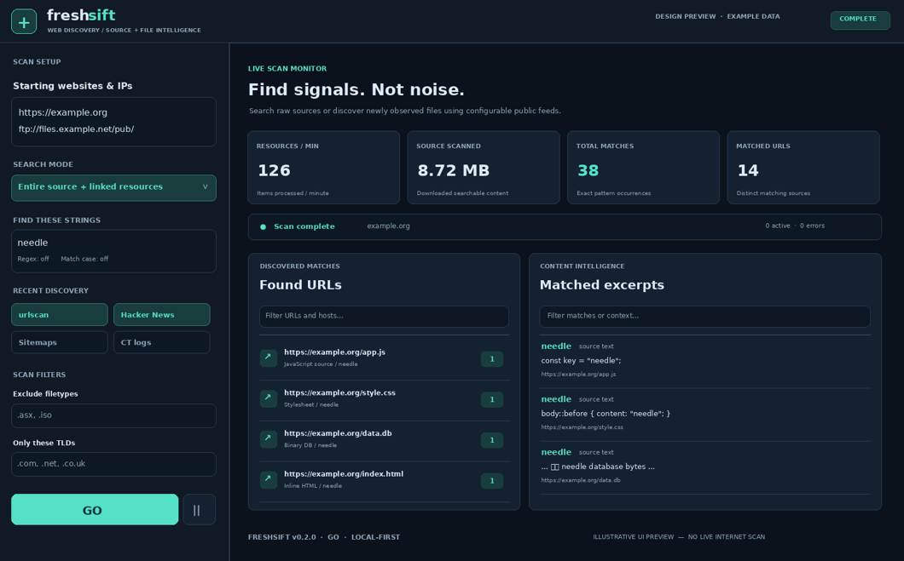

# FreshSift v0.6.0

**Local-first, single-executable Go crawler for finding content and file URLs in recently observed web resources.** It has a browser interface, but crawling and searches happen in Go on your own computer.

FreshSift supports exact strings, RE2 regex, binary/source-byte searching, and **filetype-only searches** such as `.jpg` or `.db` with no string required. It accepts pasted HTTP(S)/FTP URLs, hostnames, public IPs, and imported TXT/CSV lists. Optional discovery feeds supply recently observed URLs; the dashboard shows results, context, source provenance and live crawl statistics.



*Illustrative v0.2 interface preview with fictional URLs and matches; not a screenshot of a real internet scan.*


*Illustrative filetype-search preview. The actual application uses `web/index.html`, `web/style.css` and `web/app.js`; test your screen size in the local browser.*


## Curated starter website collections (Go + GitHub Pages)

FreshSift includes **18 selectable collections** of public starting pages, with over 150 directory, recent-post and publication URLs across fast-moving aggregators, Pastebin/Rentry/GitHub Gists, web indexes and archives (urlscan/Common Crawl/Wayback), public code forges, software releases, security advisories, news, science and AI research, public data, government notices, forums, blogs, standards and download mirrors. See **Starting websites → Curated starter websites**.

The **Fast-moving discovery hubs** category is selected by default only on a *fresh installation*. Previously saved scans and settings imports with no starter-list field retain their previous seed list without silently adding sites. All category checkboxes are independent and additive: select multiple categories, filter them by website name, inspect the included URLs, use **Recommended**, **Select all**, or **Select none**, and **Preview**, **Copy**, or **Export URLs TXT**. Expand any category to uncheck individual sites without disabling the entire category; these choices are also saved. The effective URL inventory combines manual and selected category URLs and removes exact/canonical duplicates. The dashboard saves category selections in its settings, presets and exports, but submits only the resolved URL list to Go so its existing API also remains compatible.

Starter categories contain **webpage entry URLs**, not automatic access to each external site's entire search index or database. This includes Pastebin, Rentry, Common Crawl and Wayback. The actual import tools remain the configured discovery providers (urlscan, HN, SearXNG, sitemaps/RSS, etc.). Some providers block browser cross-origin requests, require credentials or rate-limit crawlers. A connected Go engine is useful for broader reach; use the browser extension where appropriate. Per-run page limits, robots rules, filters and network restrictions remain in effect; observed timestamps are not proof of first indexing.

## Perpetual discovery and rescanning (Go + GitHub Pages)

Enable **Perpetual discovery and rescanning until stopped** under Crawl settings, and set **Refresh every (minutes)** (1–1,440; default 5). Each round re-queries the enabled discovery providers for currently observed/indexed URLs, crawls newly discovered candidates, and revisits a bounded rotating pool of up to 20,000 previously queued HTTP(S)/FTP URLs. Per-round depth, page, concurrency, host, URL-scope, robots.txt, exclusion and network-safety policies remain in force. Duplicate identical match/context pairs are suppressed across rounds; new or modified page content can generate new findings. Up to 50,000 recent matching events and a bounded 100,000-signature duplicate window are retained in memory. The UI shows the completed/active round number and the next scheduled refresh time; Pause, Resume and Stop work in continuous mode. A cycle finishes before the refresh timer starts, so a long cycle does not overlap the next.

**Go desktop / server:** Scanning runs within the Go process even after closing its browser tab. The active perpetual configuration is saved only on the local host (0600 file permissions) and automatically restarted when the Go executable launches again. The default path is under your operating system's user configuration directory, \`FreshSift/perpetual.json\`; set \`-state-file /path/to/state.json\` to choose a different location. Stop explicitly removes this restart checkpoint. Use a service manager (Windows service/task scheduler, systemd, Docker restart policy, etc.) to keep the Go process online through machine restarts. Scan matches and the revisit pool are in-memory and reset when the Go process restarts; discovery starts fresh from saved settings.

**Standalone GitHub Pages:** The identical dashboard supports perpetual **browser-side** scanning and remembers the enabled scan in local storage for resumption on re-opening the page. It runs only while that tab is open and allowed to execute JavaScript; browser throttling, sleep and tab closure interrupt it. Browser CORS limitations still apply. To continuously scan while the browser is closed, use **Connect Go engine** to an always-on, token-protected HTTPS Go instance. Pages itself is static and cannot run a persistent server-side crawler or guarantee discovery while closed. Do not confuse the separate GitHub Pages publish workflow with background crawling.

**Discovery quality:** For newly published/indexed content, combine urlscan and Hacker News with SearXNG across selected search engines, plus sitemap/RSS feeds for seed domains; optional certificate and DNS discovery augment host coverage. SearXNG requires a compatible JSON-enabled endpoint, and Pages also requires CORS or the extension. Result age from discovery sources is a best-effort observation/indexing hint, not proof of the first publication or indexing time. Third-party rate limits, feed coverage and network availability prevent any guarantee of every new URL.

**API:** Pass \`"perpetual":true\` and \`"rescanMinutes":5\` to \`POST /api/start\`. \`GET /api/status\` reports \`stats.cycles\`, \`stats.nextRunAt\` and active/waiting status. \`POST /api/stop\` stops the sequence and clears restart persistence. The feature is off by default.

## Subdomain enumeration (Go + GitHub Pages)

FreshSift can discover subdomains belonging to a seed hostname such as `example.org` or `github.io`. This runs **only when enabled** and can be used on its own (leave the string search blank), or together with ordinary page / file searches.

1. Add the parent host to **Starting websites**, e.g. `github.io` or `https://example.org/`.
2. Select **Discover subdomains of starting hosts**.
3. Check **Brute-force DNS using built-in / custom prefixes**, then keep **Include built-in common subdomain wordlist** enabled to try 342 common prefixes (such as `www`, `api`, `mail`, `dev`, `staging`, `vpn` and `git`).
4. Optionally import a TXT/CSV wordlist, or paste prefixes into **Custom subdomain words**. Words may be separated by newlines, commas, or spaces; nested prefixes such as `api.dev` are accepted. Invalid DNS labels and duplicates are ignored.
5. Optionally include **historical certificate-transparency names**, select a result limit (50–2,000), then press GO.

All discovered hostnames appear in the independent **Discovered subdomains** panel, even if the HTML search returns no content matches. Export the full inventory as CSV (hostname, DNS/CT source, DNS verification state and addresses) or copy hostnames. Discovered hostname URLs are also added to the ordinary crawl queue, subject to configured target filters, robots.txt and page budgets.

The Go version checks DNS with the local resolver; Pages uses the public Google DNS-over-HTTPS JSON endpoint. Both attempt to suppress DNS wildcard false positives by comparing two synthetic lookup names. A DNS-confirmed name has an address record at check time, but a working HTTP service is **not** guaranteed. Historical CT records are labelled **CT historical**, not DNS-verified. Browser-only operation depends on network policy, public DoH availability and CORS; the optional extension or a connected Go engine can help when browser restrictions interfere. `github.io` is a multi-tenant public suffix, so enumeration of `github.io` may find projects operated by unrelated site owners rather than one organization's assets.

Wordlists are capped at 200 KB / 5,000 unique valid prefixes, scoped to the supplied seed domains (up to five), with a 2,000-result cap and bounded concurrent DNS requests. This does not perform DNS zone transfers or guarantee exhaustive discovery; certificate logs may omit private or older names, and unusually large CT responses may be rejected (the DNS wordlist scan still operates). DNS queries and CT lookups are sent to external resolvers and certificate-log services. No third-party keys or centralized crawler proxy are needed for this feature.

Programmatic Go API: pass `enumerateSubdomains`, `subdomainWords`, `subdomainUseBuiltIn`, `subdomainUseCT`, and `subdomainLimit` in `POST /api/start`. Follow discovery progress in `GET /api/status`, then export all hosts using `GET /api/subdomains?format=csv` (also `json` or `txt`).

## DNS records, reverse DNS and independent crawl-depth controls

Both the Go server and the static GitHub Pages browser crawler expose **separate, opt-in DNS intelligence settings**:

- **Look up DNS records and search values** queries the seed domains' public DNS records; TXT, MX and other DNS answers are included in the searchable results when a search phrase or regex is supplied. Every returned record is also shown in the **DNS records** inventory, even when no phrase matches. Use **DNS-only scan** to collect and search DNS records without fetching webpages or contacting web discovery feeds.
- **Discover subdomains of starting hosts** is the master checkbox. **Brute-force DNS using built-in / custom prefixes** enables wordlist guessing (built-in list: 342 common prefixes, with TXT/CSV import); **historical certificate-transparency names** can be enabled separately. Passive CT-only searches require no guessing. The discovered subdomain inventory distinguishes DNS-confirmed names from historical CT observations.
- **Reverse DNS for IPs of crawled pages** queries the public DNS-resolved address of each successfully fetched page's hostname and finds PTR names. PTR hostnames are **forward-confirmed** (their A/AAAA answers must resolve back to the original IP) before they can be crawled. A separate **page PTR depth** setting from 0 to 8 governs links followed from each PTR hostname, independent of the ordinary crawl depth.
- **Reverse DNS on discovered subdomains with different IPs** compares a discovered hostname's DNS addresses to those of its parent seed host. For any changed address, it performs forward-confirmed PTR lookup and can crawl the resulting hostnames using a **second independent 0–8 depth limit**. This option requires enabling subdomain enumeration.

The **DNS records** and **Reverse DNS hosts** panels can be filtered and exported to separate CSV files. Existing URL, match, CSV and JSON exports continue to work. Go API users can read full inventories using `GET /api/dns-records?format=json|csv` and `GET /api/reverse-dns?format=json|csv`. New `POST /api/start` settings are `discoverDNSRecords`, `dnsOnly`, `subdomainGuess`, `reverseDNSPages`, `reverseDNSPageDepth`, `reverseDNSSubdomains`, and `reverseDNSSubdomainDepth`.

**Technical limits:** Reverse DNS/PTR is *not* a reverse-IP hosting index. Many websites share a single IP but publish no corresponding PTR record; PTR discovery cannot identify every virtual host. A PTR entry is not evidence of a hosted website unless the HTTP crawler fetches one successfully. The Go crawler records the actual HTTP transport peer IP when available (with DNS-resolution fallback), while Pages can only approximate the peer using public DNS answers; CDNs or load balancing can make those answers different from the true HTTP peer. Pages uses public DNS-over-HTTPS and requires CORS/network access; Go uses native DNS resolution for common records and PTR verification. PTR fan-out is capped to 64 distinct origin/IP lookups per scan and remains subject to URL scope filters, private/reserved-address restrictions, robots.txt and global page budgets. Subdomain CT may include stale records; reverse lookup on these names requires a current address. Depth limits apply only to successfully queued PTR-derived hostnames and do not bypass the scan's global resource caps.

## Selectable search engines (Go + GitHub Pages)

FreshSift supports optional multi-engine search with **Google, Bing, DuckDuckGo, Brave, Mojeek, Startpage, and Yandex** checkboxes, plus **Select all engines**. Advanced Research opens its query in the selected public search-engine websites; these external links **do not** import results automatically.

For **automatic discovery**, enable the **SearXNG** source, configure a public HTTPS SearXNG instance base URL, select the engines it supports, and enter a plain-text **Discovery keyword** (or a non-regex search phrase). FreshSift queries the configured instance's `/search?format=json` endpoint, paginates up to five pages, deduplicates URLs, and adds candidates to the normal crawl queue. Per-URL source provenance includes the underlying search engine when SearXNG reports it. The existing URL/domain filters, robots.txt restrictions, page budgets, and exports still apply.

The SearXNG instance must enable JSON output and the requested search engines. Public instances may disable JSON or individual engines, and search-result freshness filters are only best-effort; they do not prove first indexing. Go uses its existing public-network protections. Standalone Pages needs a CORS-enabled instance, the optional extension, or a connected Go engine. The Brave API is a separate Go-only option using `BRAVE_SEARCH_API_KEY`. Neither the retired Bing Search API nor Google Custom Search JSON API (closed to new users) is used for unrestricted direct imports.

Example `POST /api/start` fields: `"providers":["searxng"]`, `"searxngURL":"https://search.example.org"`, `"searchEngines":["google","bing","duckduckgo"]`, `"sourceQuery":"your query"`.

## GitHub Pages client-side execution (experimental)

The Pages dashboard now runs a JavaScript crawler **in the browser** when no Go engine is connected. No Go binary or external backend is needed for:

- Local file source/visible-style searches and file-extension detection (up to 8 MiB per file).
- Crawling CORS-accessible HTTP(S) pages, static linked HTML/CSS/JS assets and file URLs.
- Source / visible-style / file-extension modes; exact matches and a restricted JavaScript-regex implementation; exclusion, TLD, domain, URL and depth filters.
- Browser-side pause/resume/stop, live results and CSV/JSON/JSONL exports, plus local presets and import/export of settings.
- Best-effort public urlscan/HN/sitemap/RSS discovery if the remote API allows browser requests. Failed discovery is reported, not silently ignored.

**Optional extension:** Install the [Chromium/Edge fetch bridge](extension/README.md) locally to make HTTP(S) requests through an explicitly permissioned Manifest V3 extension service worker, avoiding ordinary page CORS restrictions. This uses **no central crawl proxy** and does not send stored site cookies or login credentials. The extension does not follow HTTP redirects; supply final URLs. It also cannot enable FTP or execute scanned webpages' JavaScript.

**Limits:** Browser regex is not Go RE2; its patterns are restricted to reduce backtracking. HTML visible mode is an approximation and not JS-rendered DOM. Robots.txt failures skip sites when robots checking is enabled. Authentication-protected sites, request throttling, private DNS/rebinding, cross-origin network policies, external service rate limits and first-indexed timestamp verification are not solved. Static GitHub Pages alone still cannot make arbitrary cross-origin or FTP requests.

To run a scan without Go, open Pages, paste target URLs or select local files, choose a mode and press GO. For sites that reject direct browser reads, use the extension. To use anonymous FTP or the full Go RE2/network engine instead, choose **Connect Go engine**.

See [feature matrix](docs/FEATURE_MATRIX.md), [browser tests](qa/browser-engine.test.cjs), and [extension documentation](extension/README.md).

## GitHub Pages — feature-identical dashboard

[Open the FreshSift Pages interface](https://djshellshoxxx.github.io/freshift/) · [Repository](https://github.com/djshellshoxxx/freshift)

**GitHub Pages and the Go desktop app use the exact same HTML, CSS and JavaScript dashboard** (`web/` is mirrored into `docs/`). Both show the same live result panes and **every search option**: exact strings, Go RE2 regex, entire HTML/JS/CSS/source/binary searching, visible text, filetype-only discovery, .asx exclusion, FTP and IP addresses, robots.txt control, TLD/domain filters, concurrency, depth and time budgets, provider age windows, advanced search links, CSV/JSON/JSONL export, pause/resume/stop and IP enrichment. Both also expose new v0.3 tools for scope preview, settings import/export, local scan history, and filtered CSV containing the URL, matching text, source, surrounding context and timestamps.

GitHub Pages cannot host Go. Its JavaScript client can now scan local files and CORS-accessible HTTP(S) targets independently, and the optional local browser extension can fetch broader HTTP(S) destinations. Connect a token-protected Go engine only when its additional behavior (notably FTP and Go RE2) is needed. This architecture does not create a public open proxy. The Windows desktop app launches a local Go engine automatically.

**Connecting Pages to your own Go backend (Unraid / Windows / Linux):**

1. Build or download FreshSift v0.6.0. Choose a long random bearer token; set `FRESHSIFT_API_TOKEN` and `FRESHSIFT_ALLOWED_ORIGIN=https://djshellshoxxx.github.io` on the crawler host. Never place the token in the Pages repository or source code.
2. Start the Go server bound to an address reachable by your TLS reverse proxy (see example). This requires both environment variables. Do not expose the bare HTTP port directly to the internet. A VPN or other access control layer is recommended in addition to the API token.
3. Publish the crawler behind a **valid HTTPS domain** (for example `https://crawler.your-domain.example`). The reverse proxy must forward `/api/` requests without stripping `Authorization`. Do not publish `/` if you only want the Pages UI accessible.
4. Open GitHub Pages, select **Connect engine**, enter the HTTPS origin and the token, then connect. Only the engine origin is saved in browser local storage; the token is stored in browser session storage (not in GitHub). Clear it with **Disconnect**.

Example Linux server launch (in a private environment behind an HTTPS reverse proxy):

```bash
export FRESHSIFT_API_TOKEN="$(openssl rand -hex 32)"
export FRESHSIFT_ALLOWED_ORIGIN="https://djshellshoxxx.github.io"
./freshsift-linux-amd64 -listen 0.0.0.0 -port 8787 -no-browser
```

Copy the generated token to a secure password manager first; changing it disconnects Pages sessions. Limit inbound port 8787 to your reverse-proxy host at the network layer. **For a reverse proxy terminating TLS, the Pages-to-engine URL must use `https://`**; browser restrictions may reject an HTTP loopback endpoint from the public Pages HTTPS origin.

GitHub Pages workflow: [`.github/workflows/pages.yml`](.github/workflows/pages.yml). **One-time activation is required by a repository administrator:** open [Settings → Pages](https://github.com/djshellshoxxx/freshift/settings/pages), and under **Build and deployment → Source**, select **GitHub Actions**. GitHub's default `GITHUB_TOKEN` can deploy to an enabled Pages site but **cannot create the Pages site**; the workflow intentionally does not attempt `enablement: true` (which fails with `Resource not accessible by integration`).

After selecting **GitHub Actions**, open the [Publish GitHub Pages workflow](https://github.com/djshellshoxxx/freshift/actions/workflows/pages.yml) and select **Run workflow** on `main`, or push a change to `docs/`, `web/`, `qa/` or the workflow file. Confirm both the `build` and `deploy` jobs succeed before treating https://djshellshoxxx.github.io/freshift/ as live. The workflow tests that the Pages dashboard matches the Go dashboard before uploading the static `docs/` site. The workflow uses GitHub's supported `actions/configure-pages` and `actions/deploy-pages` steps directly, without a custom Pages-status API preflight that could misclassify a 403 permissions failure as an unconfigured site. If the deploy job reports `Get Pages site failed: Not Found`, a repository administrator must enable Pages once under Settings; if it reports `Resource not accessible by integration`, check Actions/Pages token permissions. There is no way for a workflow using only the default `GITHUB_TOKEN` to create the Pages site automatically.

### CSV for matching strings and URLs

**Export all** with CSV chosen saves every recorded match from the Go engine, including URL, IP, source, matched string, regex/exact pattern, context before/after, timestamp and HTTP status. **Filtered CSV** exports all matching records that pass the current URL, source, selected-URL and excerpt filters (not merely the first 500 visible rows). CSV cells are escaped against spreadsheet formula injection. File discovery saves the verified file URL and extension using the same columns.

## Start on Windows

1. Download `FreshSift-windows-amd64.exe` from [Releases](../../releases) **once a release has been published**, or build from source.
2. Launch the EXE; the interface opens at **http://127.0.0.1:8787**. It binds to loopback only.
3. Paste seed URLs/IPs, or enable discovery feeds. For FTP, specify `ftp://hostname/pub/` (anonymous login only).
4. Select a **Search mode**, enter strings/regex *or* wanted file extensions, and adjust filters if needed.
5. Click **GO**. Watch the result panes and statistics, then export CSV, JSON or JSONL.

A different port: `FreshSift-windows-amd64.exe -port 8999`. Run without opening a browser: `-no-browser`.

## Search modes (v0.3)

| Mode | How it works | What is matched |
|---|---|---|
| **Entire source + linked resources (default)** | Fetches HTML source plus referenced CSS, JavaScript, static media and file URLs; follows CSS `url(...)` / `@import` and static JavaScript imports. Reads HTTP(S) and FTP file bodies up to **8 MiB per resource**. | Exact strings or RE2 regex **in downloaded source bytes**, including markup, scripts, styles, plain text, binary `.db` files, and other fetched resources. Binary bytes are scanned, not decoded into a database schema or image text. |
| **Visible webpage text only** | Fetches and extracts visible-style HTML text or text/plain from navigable pages; skips embedded resources. Does not execute JavaScript. | Strings/regex in visible/plain text; not CSS, JS, HTML tags, or binary files. |
| **Discover filetypes** | Enter extensions such as `.jpg, .jpeg, .db` with **no string required**. Finds candidates from manual URLs, recent-source URLs, HTML links, HTML/CSS references and anonymous FTP listings. HTTP `HEAD` and FTP `SIZE` verify availability; range GET / FTP transfer-start fallbacks handle servers without the metadata methods. | One verified file URL result per target extension. Download of the entire matching binary file is not required. |

**Default resource behavior:** linked assets are fetched at the current page depth even when **Follow links = 0**. Link depth controls navigation to additional pages and FTP subdirectories. Resource discovery is static; dynamic links created by executing JavaScript are not followed. Embedded assets may be hosted on external domains even when **Follow external page/navigation links** is off; allow/deny domains and TLD filters still apply.

### Filters and controls

- **Exclude filetypes** — e.g., `.asx, .iso, .mp4`; case-insensitive, matched against the URL path before fetching (query strings ignored). Any other type, **including `.db`**, remains eligible.
- **Only these TLDs** — e.g., `.com, .org, .co.uk`. If set, IPv4/IPv6 literal targets are excluded; leave blank to scan IPs.
- **Only these domains** / **Exclude these domains**, plus URL includes/excludes.
- **Respect robots.txt** — **on by default** for HTTP(S). Uncheck to skip robots policy checks. FTP does not use HTTP robots.txt.
- **Enable anonymous FTP** — **on by default** in the UI. Only anonymous, passive-mode **plain FTP** is implemented. The client is read-only; authenticated FTP, FTPS/SFTP, uploads and active-mode FTP are not implemented. The passive data connection uses the validated server IP, not the IP supplied by a server in PASV responses.
- **Follow external page/navigation links** — off by default; separate from linked resource loading.
- **Crawl budgets** — link depth 0–8, absolute/extra URL directory depth, global and per-host resource caps, concurrency/host pacing, time-per-site budget, network timeout.
- **LAN/private IPs** — disallowed by default, including FTP and redirected HTTP targets; checkbox required for local/private testing.

A URL with multiple extensions can match a compound extension such as `.tar.gz` when specified; exported records retain the selected extension, source, status and observed timestamp when known. Search results are kept in memory until exported.

## Discovery feeds and age fields

| Feed | What an age window indicates |
|---|---|
| urlscan.io | Public scan observation time (subject to quota) |
| Hacker News / Algolia | Time the URL was submitted |
| RSS / Atom | Publication/update timestamp if the feed supplies it |
| Sitemaps | `<lastmod>` if supplied; may be missing or inaccurate |
| crt.sh Certificate Transparency | Certificate log timestamp for names **under seeded domains** |
| Brave Web Search API | `freshness=pd` search results; requires `BRAVE_SEARCH_API_KEY` |

**“Recently observed” does not mean “first indexed.”** No feed here proves that Google or another search engine first indexed a particular `.jpg`, `.db` or webpage within the last 24 hours. For a linked image, the observation timestamp generally belongs to the source page, **not the image**, so the image result does not inherit that timestamp. Manually supplied links and FTP listing entries do not have a verified index age. Sources may rate-limit searches or provide no results.

URLScan can optionally use `URLSCAN_API_KEY`; it and Brave credentials are read from Go process environment variables, never embedded in frontend JavaScript. The browser UI itself uses no remote trackers, scripts or fonts. The advanced search section links to Google, Bing, Brave, DuckDuckGo, Mojeek and Yandex; those links **do not import results**. InternetDB can enrich one specific public IP, not discover all recent IPs.

## Results and exports

- **Found URLs pane** — select a URL to filter the matching details.
- **Matched excerpts / Found files pane** — for source/visible modes: matched phrase and bounded context before and after; for file mode: discovered URL and matched extension.
- **Live statistics** — resources per minute, scanned content MB, matched strings or found files, distinct matched URLs, errors and progress.
- **Pause / resume / stop**, local configuration presets, quick URL copy and source/result text filters.
- **Exports** — CSV, JSON, JSON Lines. CSV escapes formula-leading fields; file results include `Kind=file` and `Area=File URL`.

Bounds: 8 MiB per downloaded body or FTP directory listing, 200 string occurrences per resource, up to 50,000 stored results per run and 500 live entries per pane. The results remain in memory; export before starting a new run or closing the program. File discovery validates availability rather than retrieving large binary bodies. The crawler is not a full browser, does not run page JavaScript, does not search password-protected FTP, and does not guarantee exhaustive file discovery.

## Architecture

```text
Manual HTTP(S) / ftp:// seeds       Recent observation sources
                  \                 /
                   URL normalization
                   filters / dedupe
                           |
              Concurrency-limited Go workers
             /             |             \
  HTTP(S) pages    CSS / JS / files     anonymous FTP
             \             |             /
           source bytes / visible text / file URL verification
                           |
                     match records
                           |
              local dashboard + export files
```

## Build and QA

Go 1.23+; no third-party Go modules required. Node 22+ runs optional UI contract tests; Python 3 runs optional local HTTP API smoke tests.

```bash
go test -race ./... -count=1 -timeout=90s
go vet ./...
node --check web/app.js
node qa/ui-contract.test.cjs
go build -o dist/freshsift-linux-amd64 .
python3 qa/api-smoke.py ./dist/freshsift-linux-amd64
```

Cross-compile Windows x64 from Linux/macOS:

```bash
GOOS=windows GOARCH=amd64 CGO_ENABLED=0 go build -trimpath -ldflags='-s -w' -o dist/FreshSift-windows-amd64.exe .
```

PowerShell on Windows: `go build -trimpath -ldflags="-s -w" -o FreshSift-windows-amd64.exe .`

Tests use local HTTP and mock anonymous FTP servers, including robots toggles, `.asx` exclusion, TLD scoping, HTTP `HEAD` fallback, FTP directory listings, byte searching in `.db`, binary context bounding, HTML/CSS/JS asset traversal, and filetype-only exports. See **[QA results and limitations](docs/QA.md)**. Browser visual end-to-end testing was blocked by a managed Chromium URL policy in the build environment; screenshots above are explicitly illustrative.

The GitHub workflows validate format, Go vet, race tests, UI control contracts, unified Pages parity, local HTTP API smoke tests, and Windows compilation. A `v*` tag triggers a Windows x64 **prerelease**; a new repository must first exist, with GitHub Actions enabled and publish permissions for Releases. The repository is already created at `djshellshoxxx/freshift`. To publish from a local checkout:

```bash
git init && git add . && git commit -m "FreshSift v0.2.0 source and file discovery"
git branch -M main
gh auth login
git remote add origin https://github.com/djshellshoxxx/freshift.git
git push -u origin main
git tag v0.2.0
git push origin v0.2.0
```

If the repository already exists, do **not** re-create it; add its remote, push the changes and tag through your normal workflow. Check GitHub Actions logs and release assets rather than assuming publication succeeded.

## API (local loopback)

`POST /api/start`, `/api/pause`, `/api/resume`, `/api/stop`; `GET /api/status`, `/api/version`, `/api/export?format=csv|json|jsonl`, `/api/ip?ip=1.1.1.1`.

Example filetype-only scan:

```json
{
  "seeds": "https://example.org\nftp://ftp.example.org/pub/",
  "searchMode": "files",
  "fileTypes": ".jpg, .db",
  "excludeFileTypes": ".asx",
  "allowedTLDs": ".org",
  "respectRobots": true,
  "enableFTP": true,
  "depth": 1,
  "maxPathSegments": 5,
  "maxPages": 200,
  "providers": ["urlscan"]
}
```

## License

MIT; see [LICENSE](LICENSE).
